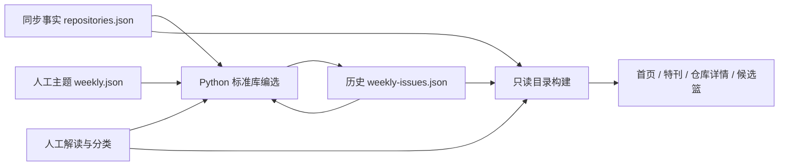

# V1.7 每周收藏特刊：让旧收藏重新进入视野

设计日期：2026-10-13。首轮按用户要求完成设计、开发和验证后停在本地；同日用户追加授权提交、推送和部署。实施与发布结果另记于交付记录，本文的验收项不代表已经通过。

实施状态：2026-10-13 已完成本地开发与验收，已获准发布。具体证据、发布状态及限制见 [v1.7 交付记录](docs/14-v1.7-delivery.md)。

## 1. 问题、目标与边界

收藏能保存入口，却不一定带来再次阅读。项目库解决“我知道要找什么”，时间线解决“那时收藏了什么”，每周特刊解决“这一周值得重新翻开哪几个，以及从哪里读起”。

当前本地目录有 328 条记录、321 篇结构完整的解读；排除已退出公开 Stars、个人归档、上游归档、资料受限和未分类条目后，311 个可参与选编，其中 206 个已收藏至少 90 天。数量来自本次目录快照，不代表实时 GitHub 状态或质量评分。

成功标准：用户从首页进入一期稳定的特刊，在少量候选中选一个，带着问题阅读已有解读的用途、步骤和示例，返回原期继续浏览，或把需要的仓库加入已有候选工具篮。

- 保留“回顾、理解、如何使用”的定位。深入学习通过阅读引导实现，不恢复学习阶段、笔记、完成统计或打卡。
- “收藏满 90 天”是可解释的旧收藏规则，不推断用户多久没看，也不保证项目适用于今天。
- 规则选编、公开资料整理、GitHub 同步事实分开标注。没有 AI 自动分类或凭空生成的新仓库结论。
- 不增加账号、数据库、服务端任务平台、浏览追踪、邮件通知、跨设备阅读状态。

参考：GitHub 官方将 Star 定义为方便之后找回项目的入口，并提供搜索与筛选；本功能补充周期性重访的入口（[官方说明](https://docs.github.com/en/get-started/exploring-projects-on-github/saving-repositories-with-stars)）。Readwise Reader 的 Daily Digest 将已保存的内容重新放回阅读入口，可作为“有限篇数、集中呈现”的产品参考（[官方说明](https://docs.readwise.io/reader/docs/faqs/daily-digest)）。这里不据此声称本功能已经改善记忆效果。

## 2. 一期的内容结构

一期最多五个仓库：一个主读、两个同主题延伸、两个不同领域的偶遇。围绕已有人工领域分类轮换八个主题；首期从 Web、前端与跨端开始。

| 位置 | 内容 | 用户动作 |
| --- | --- | --- |
| 封面 | 期号、北京时间周一至周日、主题标题、一句话阅读方向 | 直接开始主读，或跳到本期目录 |
| 主读 | 真实头像、仓库名、收藏事实、选入缘由、已有用途摘要 | 先回想用途，展开阅读摘录，进入完整解读 |
| 重读路径 | 它解决什么、适用边界、怎样开始/一个例子 | 展开真实的资料段落；从对应章节继续阅读 |
| 同主题延伸 | 两个仓库的摘要、选入缘由、来源状态 | 比较不同切入点，阅读解读或加入候选 |
| 换个领域 | 两个跨领域仓库 | 找回不在最近关注方向里的收藏 |
| 往期目录 | 实际已生成的期号、日期、主题 | 选择往期，链接可刷新和分享 |
| 编选说明 | 规则、来源更新时间、资料核查边界 | 理解为何出现这几个仓库 |

重读路径复用人工解读的二级章节，标题和正文来自原文；优先“它是什么 / 适合什么场景 / 如何开始 / 一个使用示例”，不拼造新的使用说明。代码示例仍保留“未执行”等原文提示。正文较长时折叠阅读，完整资料及来源仍在详情中。

首期之前不伪造往期；一期可少于五条，并说明候选不足。若没有符合条件的条目，不写入空期、不显示虚构特刊。

## 3. 用户流程与视觉

首页在封面之后、领域目录之前增加横向特刊封面：醒目的期号与主题、主读头像和名称、一个主要动作“打开本期”。沿用纸白、近黑、单一洋红、细分割线与等宽仓库名。

顶级“收藏回顾”保持现有入口与时间线深链接；回顾页和特刊页共用二级导航“每周特刊 / 收藏时间线”。特刊的 URL 为 `?view=weekly&issue=2026-10-12`，不传 issue 时打开最近实际生成的一期。旧期 URL 不随周次变化。

详情沿用现有排版，来自特刊时补充“正在重读第 N 期”上下文及返回入口。刷新、直接打开详情、新标签页也可通过 issue 参数回到对应期。普通项目库、专题、任务配方与候选篮继续保持各自来源。

手机改为顺序阅读：封面 → 主读 → 折叠阅读段落 → 延伸与偶遇 → 往期。按钮不嵌入仓库链接，展开区可用键盘操作；长仓库名、代码与窄屏不撑破页面。章节锚点避开页头遮挡。

## 4. 编选规则 v1

1. 每周按 `Asia/Shanghai` 划分，周一 00:00 开始。生成端确定日期，浏览器不根据时钟临时换名单。
2. 候选必须仍在公开 Stars，未个人归档、未上游归档，已有结构完整解读且已分类。README 已变化或暂时不可读不强行等同于项目失效，阅读时继续展示现有待复核提示。
3. 最近 8 周入选过的仓库不再进入当期候选。不为凑满五个突破这一间隔。
4. 按上期之后的主题顺序选择下一个有候选的领域，最多取三个。其余最多两个来自不同的其他领域。主题暂时无候选则顺延；全部无候选则不生成。
5. 每组排序：收藏满 90 天优先；从未入选或最久以前入选优先；同等条件用 `SHA-256(周一起始日:repoId)` 排序。后一规则只打散同优先级条目，不赋予质量分，不依赖数组顺序、随机数或 Stars 热度。
6. 每个条目保存当时的名称、分类、收藏日期、收藏天数和上次入选日期。UI 据这些证据说明“为什么再次出现”；当前项目状态来自最新目录。
7. 同一期首次生成后保持不变；未来同步只更新实时事实和解读。归档保存的是名单与编选依据，不是上游 README 或解读的历史全文。
8. 跳过的周次不补造期刊；期号按实际生成次数递增。页面显示最近一期的真实日期，跨周未更新时提示等待下一次成功构建。

## 5. 数据与执行链路

- `config/weekly.json`：人工维护主题标题、导语、阅读问题与领域关联。
- `data/weekly-issues.json`：仅 `scripts/generate_weekly.py` 写入，提交后成为每期可追溯的来源文件；第一期在本地生成，随获准的功能发布上线。
- `scripts/weekly_catalog.py`：配置/档案校验、北京时间边界、纯函数编选、前端投影。与同步脚本分开，不写事实和人工 Markdown。
- `build_catalog.py`：读取并校验已存在档案，输出 `weeklyIssues`；构建不自动造新期。
- `verify_data.py`：增加主题及档案检查；坏档案拒绝构建，不静默覆盖。
- GitHub Actions：接入现有定时同步流水线，校验后生成当期、再校验；已有自动提交源数据步骤只增加档案文件。定时构建成功后才会出现在网站，不能承诺周一零点准时上线。远程发布在用户追加授权后执行。
- 前端 `domain/weekly.js`、`WeeklyView`、特刊入口组件与独立样式；不再往宿主累积选编逻辑。

档案 schema v1：根 `schema_version`、`issues[]`；一期包含 `id`（周一日期）、递增 `number`、`week_end`、`generated_at`、`facts_checked_at`、`selection_version`、人工编辑主题快照、`entries[]`。条目含 `repo_id`、`slot` 与独立的 `selection` 事实快照。投影后使用前端 camelCase。

校验期号/日期不重复、周一起始/周日结束、生成时间属于该周、数据检查不晚于生成时间、入选时未收藏不允许、角色数量和领域约束、重复 repoId、相邻八周重复、字段类型。历史引用仓库后来不存在时保留期刊和条目占位，不让历史档案破坏项目库；不伪造现存资料。

## 6. 失败路径与风险取舍

| 情况 | 行为与依据 |
| --- | --- |
| 重复执行、同步后重新构建 | 当期幂等，文件不变；避免阅读名单漂移，属于当前直接需求 |
| 原文件损坏或未来日期冲突 | 报错且不写；保护历史档案，错误频率未知，数据错乱属 A 级后果 |
| 写入中断 | 复用已有原子文件替换；不引入锁、重试队列或额外协调状态 |
| 多个 CI 同时提交 | 沿用 Git 推送冲突暴露失败，不覆盖远端；频率未知，本轮不增加并发锁 |
| 候选不足/只有一个领域 | 少量出刊并说明，不重复填充，不放宽归档/完整解读约束 |
| 旧期仓库已归档、退出 Stars、被移除 | 标明当前状态或显示不可用占位；不把它当作当前推荐，不自动替换原名单 |
| optional weekly 数据缺失/损坏 | 前端显示特刊空态/错误入口，其余目录继续可用；构建校验仍拒绝坏数据 |
| 来源已变化、示例未执行 | 使用现有来源提示与原文标注，不承诺可运行性、安全性或技术适配 |

不新增追踪用户阅读、遗忘程度或学习完成度的机制；也不处理主动通知、离线同步、多用户个性化或上游工具实际运行验收。

## 7. 开发批次与验收

1. 数据与规则：配置、档案生成、校验、构建与 CI 接线，真实目录生成第一期。
2. 阅读体验：首页入口、回顾导航、特刊主读与摘录、往期、详情返回、候选篮复用。
3. 验证修复：Python 边界/幂等/冷却/候选不足测试，前端路由/投影/摘录/失效引用测试，完整项目回归与真实浏览器检查。

必跑：Python 单元测试、`verify_data.py`、`npm --prefix app run test`、`npm --prefix app run test:sites`、`GITHUB_PAGES=true npm --prefix app run build`。再用真实浏览器验证首页至特刊、展开阅读、章节跳转、刷新及返回、往期选择、异常期号、候选篮、桌面/窄屏和页面错误日志。

跨周与八周间隔在临时测试数据中模拟，不将未来测试期写入真实档案。保存实际结果和未覆盖边界；清理本轮测试标签页和临时产物，保留用户已有截图改动。交付时分别核实本地验收与线上发布状态。
